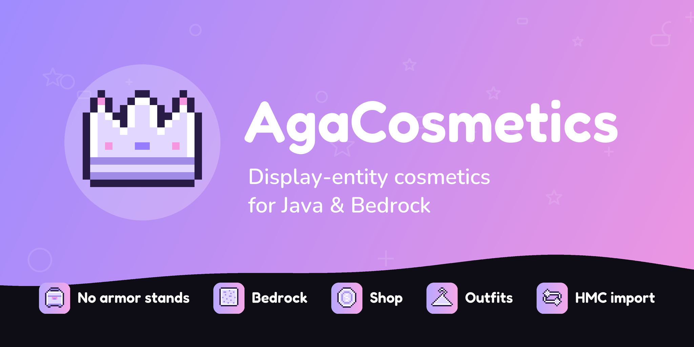

# AgaCosmetics

Cosmetics for Paper and Folia servers, drawn with **display entities** for Java and Bedrock players: hats,
armor, held items, backpacks, balloons, shoulder pets and particle auras.

Every model exists only as packets. Nothing is spawned on the server, nothing lags behind the player, and there
are no armor stands. Bedrock players see the same cosmetics through GeyserDisplayEntity.

## Highlights

| | |
|---|---|
| **Display entities** | Backpacks, balloons and pets ride the player and turn in the same tick as the body. |
| **Full Bedrock support** | Same models on Bedrock, their own position fixes, native form menus. |
| **Shop, gifts & rentals** | Put a price on any cosmetic; give cosmetics for a while or for good. |
| **Outfits & styles** | Players save whole looks; one cosmetic can come in many styles. |
| **Animations** | Bob, sway, tilt, spin, pulse and flipbook frames, played by the client. |
| **Showcase stands** | Figures in your spawn or shop wearing a set look. Players click one to try it on. |
| **Try before buying** | Right-click a locked cosmetic in the menu to wear it for a few seconds, anywhere. |
| **HMCCosmetics compatible** | Same cosmetic, menu and wardrobe format. One-command migration. |

## Where to start

- New server: [Installing](getting-started.md)
- Coming from HMCCosmetics: [Migrating](migrating.md)
- Bought an MCModels or other cosmetics pack: [Adding cosmetic packs](packs.md)
- Bedrock players on your server: [Bedrock](bedrock.md)
